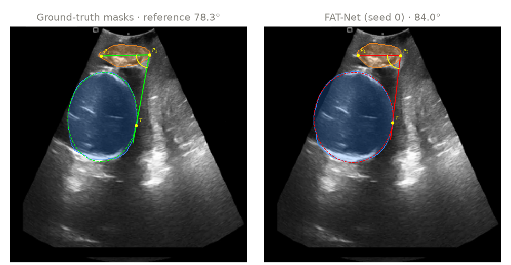

<h1 align="center">FetalIntrapartumNet</h1>

<p align="center">
  <b>Standard-plane selection, FH/PS segmentation and angle-of-progression measurement<br>
  in intrapartum transperineal ultrasound</b>
</p>

<p align="center">
  
  
  
  
  
</p>

Official code for the paper **"FetalIntrapartumNet: a controlled evaluation of standard-plane selection,
segmentation and angle-of-progression measurement in intrapartum transperineal ultrasound"**
by B Lakshmanan<sup>1,\*</sup>, Vivek Raja P S<sup>2</sup>, J Aron Yuvaraj<sup>1</sup> and M P Nitharsan<sup>1</sup>
(*Sadhana*, submitted 2026).

<sup>1</sup> Department of Computer Science and Engineering, Mepco Schlenk Engineering College, Sivakasi, Tamil Nadu, India
<sup>2</sup> Aivar Innovations, Bengaluru, Karnataka, India
<sup>\*</sup> Corresponding author

<p align="center"></p>

## Highlights

- **One protocol for every model.** Seven plane classifiers (DeepFetalNet and six published networks) and four
  segmenters (AoP-GAU-Net, U-Net, FAT-Net, MALUNet) are trained with the same data, augmentation, budget and model
  selection, on a split of JNU-IFM in which no woman appears in more than one subset.
- **Classifier comparisons with uncertainty.** Classifiers are compared by patient-grouped 5-fold cross-validation
  over all women of JNU-IFM, with per-fold results, three seeds on the locked split and bootstrap confidence
  intervals.
- **Two external test sets.** Segmentation and the AoP are also measured on the IUGC 2024 test set and on the frames of
  the IUGC 2025 release whose recordings were not used for training or validation.
- **AoP baselines.** Every AoP error is shown next to a constant prediction (the training mean) and the error of
  the ground-truth masks themselves, the floor of the geometric construction.
- **Every number is traceable.** The per-frame outputs of every reported run are committed in `results/`; the tables
  and charts below are generated from them by `fin readme-table` and `fin repo-figures`.

## Results

<!-- BEGIN RESULTS TABLE -->

**Standard-plane classification.** Patient-grouped 5-fold cross-validation over all JNU-IFM women (mean ± SD over folds) and the locked test split (630 frames; mean ± SD over seeds 0, 1, 2); threshold 0.5. Best mean in bold.

| Model | CV macro-F1 (%) | CV AUC | Test accuracy (%) | Test macro-F1 (%) | Test AUC |
|---|---:|---:|---:|---:|---:|
| DeepFetalNet | 71.1 ± 4.3 | 0.798 ± 0.053 | 69.5 ± 1.1 | 65.8 ± 0.6 | 0.763 ± 0.013 |
| PSFHSP-Net | 71.6 ± 7.4 | 0.797 ± 0.088 | 69.5 ± 1.8 | 63.2 ± 2.8 | 0.761 ± 0.012 |
| ResNet-152 | 73.9 ± 1.9 | 0.829 ± 0.059 | 73.8 ± 0.4 | 70.4 ± 2.1 | 0.836 ± 0.011 |
| SqueezeNet 1.1 | **75.7 ± 4.3** | 0.830 ± 0.041 | 71.6 ± 3.4 | 67.7 ± 5.2 | 0.806 ± 0.051 |
| ShuffleNetV2 1.0x | 74.1 ± 5.8 | 0.811 ± 0.090 | 76.3 ± 1.7 | 74.8 ± 1.9 | 0.798 ± 0.027 |
| MobileNetV2 | 75.3 ± 5.8 | **0.834 ± 0.069** | 73.8 ± 2.1 | 72.0 ± 3.9 | 0.825 ± 0.031 |
| MobileNetV3-Large | 72.2 ± 8.2 | 0.820 ± 0.069 | **77.3 ± 3.0** | **75.6 ± 3.9** | **0.869 ± 0.014** |

**Segmentation and angle of progression.** Per-image Dice (%) of the fetal head (FH) and pubic symphysis (PS), and the mean absolute error (degrees) of the AoP measured from the predicted masks with the FH-PS-AoP challenge geometry (mean ± SD over 3 seeds). IUGC 2025 unseen: the 225 frames of the IUGC 2025 release whose recordings are in neither our training nor our validation split. Best mean in bold.

| Model | Dice FH, JNU | Dice PS, JNU | Dice FH, IUGC 2024 | Dice PS, IUGC 2024 | AoP MAE, JNU | AoP MAE, IUGC 2024 | AoP MAE, IUGC 2025 unseen |
|---|---:|---:|---:|---:|---:|---:|---:|
| AoP-GAU-Net | 93.5 ± 0.2 | 85.4 ± 1.3 | 86.6 ± 3.3 | 75.4 ± 2.2 | 7.14 ± 0.91 | 14.15 ± 1.29 | 15.24 ± 0.71 |
| U-Net | 93.3 ± 1.2 | 85.2 ± 1.0 | 88.1 ± 1.9 | 76.4 ± 1.6 | 6.37 ± 0.47 | 10.37 ± 1.01 | 11.06 ± 0.92 |
| FAT-Net | **93.8 ± 0.3** | **86.9 ± 1.1** | **91.4 ± 0.5** | **83.3 ± 1.5** | **6.36 ± 0.23** | **8.55 ± 1.15** | **9.49 ± 1.13** |
| MALUNet | 91.1 ± 0.8 | 79.2 ± 3.9 | 84.8 ± 2.7 | 73.0 ± 1.9 | 9.37 ± 1.23 | 14.47 ± 0.62 | 15.70 ± 0.83 |
| AoP-GAU-Net regression head | | | | | 9.61 ± 1.87 | 11.84 ± 0.89 | 12.35 ± 0.45 |
| Constant prediction (90.45°, training mean) | | | | | 10.08 | 12.83 | 13.05 |
| Ground-truth masks (floor of the geometry) | | | | | 0 (reference) | 3.47 | 3.44 |

Generated by `fin readme-table` from `results/runs` and `splits/frames.csv`; definitions in [docs/RESULTS.md](docs/RESULTS.md).

<!-- END RESULTS TABLE -->

<p align="center"></p>
<p align="center"></p>
<p align="center"></p>

<p align="center"></p>
<p align="center"><sub>AoP construction on a JNU-IFM test frame (median error of the segmenter with the lowest
JNU-IFM error, seed 0): fetal head in blue, pubic symphysis in orange; P<sub>1</sub>P<sub>2</sub> is the symphysis axis
and T the tangent point on the head. Image from JNU-IFM (Lu et al., CC BY 4.0).</sub></p>

## Key findings

- **Plane classification.** In cross-validation SqueezeNet 1.1 has the highest mean macro-F1 (75.7%) and
  DeepFetalNet the lowest (71.1%), with fold SDs of 1.9 to 8.2 points. For no baseline does the 95% bootstrap CI
  of the difference to DeepFetalNet exclude zero, in macro-F1 or in AUC. On the locked test split (8 videos)
  MobileNetV3-Large has the highest accuracy, macro-F1 and AUC, and its paired differences to DeepFetalNet exclude
  zero on all three; in cross-validation it ranks fifth of seven by macro-F1.
- **Segmentation.** FAT-Net has the highest mean Dice for both structures on JNU-IFM and IUGC 2024 and the lowest
  mean AoP error on all three test sets. On JNU-IFM its AoP error (6.36°) and that of U-Net (6.37°) differ by 0.01°,
  and their confidence intervals overlap.
- **AoP against the constant.** On JNU-IFM the seed-mean error of every segmenter is below the constant prediction
  (10.08°), although one MALUNet seed (seed 0, 10.72°) is above it. On both external sets FAT-Net and U-Net are below the constant in every seed, and the geometric AoP of
  AoP-GAU-Net and MALUNet is above it in every seed. The AoP-GAU-Net regression head is below the constant on both
  external sets on average (11.84° vs 12.83° on IUGC 2024, 12.35° vs 13.05° on the unseen IUGC 2025 frames). On IUGC 2024 the best
  error (FAT-Net, 8.55°) is 5.1° above the error of the ground-truth masks (3.47°).
- **End to end.** With the DeepFetalNet gate and AoP-GAU-Net on the JNU-IFM test split, the AoP error on the
  forwarded Standard frames is 6.19°, 6.53° and 7.35° for seeds 0, 1 and 2, and the gate forwards 123, 155 and 122
  of the 251 Non-Standard frames, which have no reference angle.

The pipeline is a research tool and not a clinical decision aid.

## Quickstart

```bash
git clone https://github.com/Vivek0712/FetalIntrapartumNet.git && cd FetalIntrapartumNet
python3.12 -m venv .venv && . .venv/bin/activate
pip install -r requirements.txt -r requirements-dev.txt
pip install -e .                 # the `fin` command; configs/, splits/ and results/ stay in the checkout
fin fetch-third-party            # FAT-Net, MALUNet and the challenge AoP code, at pinned commits
pytest -q                        # tests (no dataset needed)
```

On Linux with an NVIDIA GPU, install the CUDA build of `torch==2.15.0` and `torchvision==0.29.2` first
([docs/ENVIRONMENT.md](docs/ENVIRONMENT.md)). The device is picked automatically: CUDA, then Apple MPS, then CPU.

```bash
fin --help                                         # every command; `fin <command> --help` for its options
fin readme-table && fin repo-figures --only pipeline charts   # README tables and charts from results/
fin train-seg --model fatnet --seed 0 --out work/runs/seg/fatnet/seed0
fin eval-seg  --run work/runs/seg/fatnet/seed0
```

## Data

The datasets are public under CC BY 4.0 and are not redistributed here. [docs/DATA.md](docs/DATA.md) gives the
files, checksums, folder layout and preparation commands.

| Dataset | Use | Source |
|---|---|---|
| JNU-IFM (78 videos, 51 women, 6224 frames) | training, validation, internal test | figshare, [doi:10.6084/m9.figshare.14371652.v2](https://doi.org/10.6084/m9.figshare.14371652.v2) |
| FH-PS-AoP challenge training set (MICCAI 2023) | reference AoP of the JNU-IFM frames | Zenodo, [doi:10.5281/zenodo.7851339](https://doi.org/10.5281/zenodo.7851339) |
| IUGC 2024 (DatasetV3) | external test of segmentation and AoP | Zenodo, [doi:10.5281/zenodo.17655183](https://doi.org/10.5281/zenodo.17655183) |
| IUGC 2025 release (469 images) | second external AoP test | Zenodo, [doi:10.5281/zenodo.17356295](https://doi.org/10.5281/zenodo.17356295) |

## Reproducing the paper

```bash
export FIN_WORK=$PWD/work
JNU_RAW=... FHPSAOP_DIR=... IUGC24_ROOT=... FIN_EXT469=... scripts/run_pipeline.sh
```

The stages are `data cls cls_cv cls_authorsplit seg ext469 e2e robustness efficiency report`. Each runs on its own
(`scripts/run_pipeline.sh seg report`) and skips finished work. The reported models were trained and evaluated on
four NVIDIA GeForce RTX 3090 GPUs (CUDA 13.2, one run per GPU); all stages from `data` to `robustness` took 5 h 13 min
of wall-clock time. The efficiency benchmark (Table 2 of the paper) ran on an Apple M4 Pro (MPS and CPU). Training on
Apple MPS or on a single GPU is also supported. [docs/REPRODUCE.md](docs/REPRODUCE.md) gives the commands, per-stage
times, multi-GPU settings and expected outputs, and [docs/RESULTS.md](docs/RESULTS.md) explains where every reported
number comes from.

## Repository layout

```
FetalIntrapartumNet/
├── src/fin/              the `fin` package (distribution `fetalintrapartumnet`) and the `fin` command
│   ├── data/             JNU-IFM build, FH-PS-AoP matching, IUGC 2024 build, splits, caches, datasets
│   ├── models/           DeepFetalNet, six classifier baselines, U-Net, AoP-GAU-Net, FAT-Net and MALUNet wrappers
│   ├── training/         classification and segmentation training, losses
│   ├── evaluation/       metrics, test-set evaluation, aggregation, IUGC 2025 set, end-to-end pipeline
│   ├── robustness/       image corruptions and the corruption benchmark
│   ├── efficiency/       parameters, MACs, latency and throughput
│   ├── reporting/        result values, tables, figures, README tables and charts
│   ├── geometry.py       AoP construction around the challenge function
│   └── pipeline.py       resumable run schedules
├── configs/              every hyperparameter of the reported runs (YAML)
├── splits/               locked patient split, cross-validation folds, video-level split, IUGC 2025 provenance
├── results/runs/         metrics, per-frame outputs and logs of every reported run (no checkpoints)
├── scripts/              end-to-end reproduction script
├── docs/                 DATA, REPRODUCE, MODELS, RESULTS, ENVIRONMENT; assets/ holds the README figures
└── tests/                unit and consistency tests
```

## Third-party code

FAT-Net, MALUNet and the FH-PS-AoP challenge AoP function carry no licence, so they are not copied into this
repository. `fin fetch-third-party` downloads each file from its original repository at a pinned commit, checks its
SHA-256, and `fin` applies our documented changes in memory. Code adapted from torchvision (BSD-3-Clause) and
mobilenetv2.pytorch (Apache-2.0) keeps its licence, in `third_party_licenses/`. [THIRD_PARTY.md](THIRD_PARTY.md)
lists every external source.

## Citation

```bibtex
@article{lakshmanan2026fetalintrapartumnet,
  title   = {{FetalIntrapartumNet}: a controlled evaluation of standard-plane selection, segmentation and
             angle-of-progression measurement in intrapartum transperineal ultrasound},
  author  = {Lakshmanan, B and Vivek Raja, P S and Aron Yuvaraj, J and Nitharsan, M P},
  journal = {Sadhana},
  note    = {Submitted},
  year    = {2026}
}
```

## Licence and contact

The code is released under the [MIT licence](LICENSE); the datasets keep their own licences (CC BY 4.0).
Questions about the paper: B Lakshmanan, Department of Computer Science and Engineering, Mepco Schlenk Engineering
College, Sivakasi (lakshmanan@mepcoeng.ac.in). Questions about the code: please open an
[issue](https://github.com/Vivek0712/FetalIntrapartumNet/issues).
